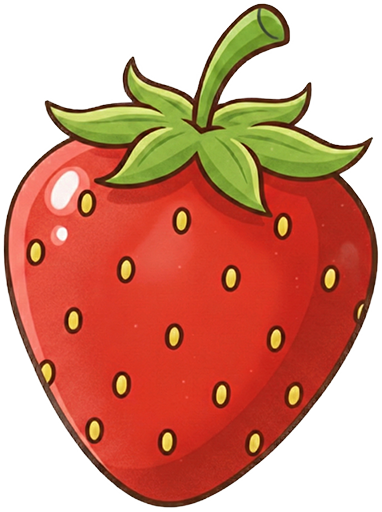
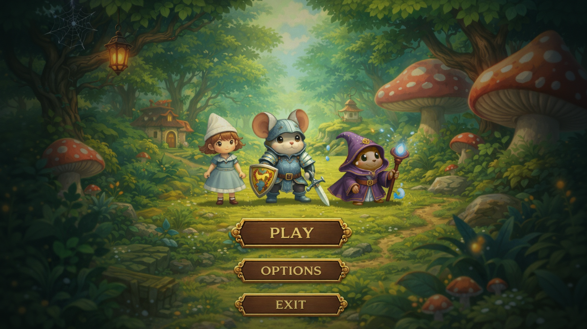
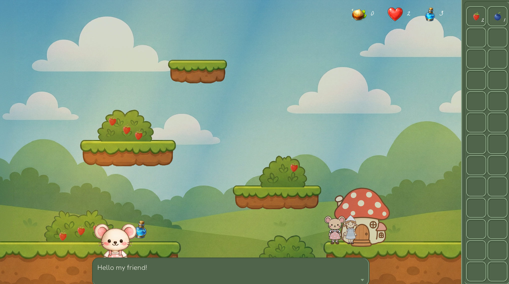
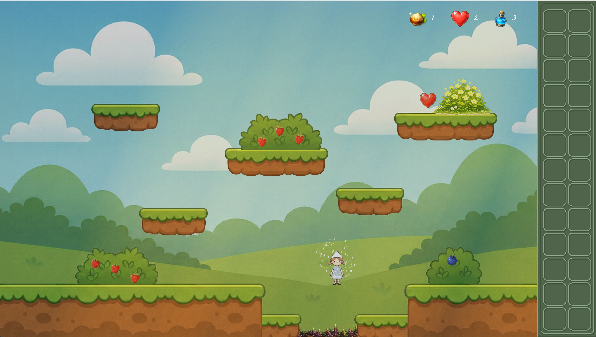
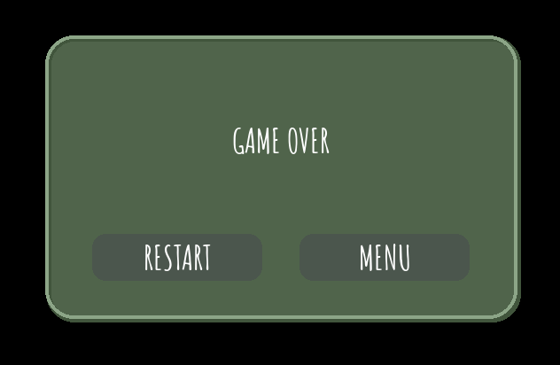

<p align="center">
  
</p>

<h1 align="center">Fruit World</h1>

<p align="center">
  A little platform adventure about friends who live in a tiny world.
</p>

<p align="center">
  
  
  
</p>

## About

Fruit World is a personal learning project built with Python and Pygame. It follows Sara through a small illustrated world filled with platforms, berry bushes, and animal friends.

Most game systems are implemented by me directly in Python: the game loop, movement and gravity, collision handling, animation logic, inventory, dialogue, quests, and UI components. Pygame provides the foundations for window management, rendering, input handling, audio, and timing.

The project is a way to develop a practical understanding of Python and object-oriented design by building these systems and connecting them into a working game. The game text is in English.

## Features

- Explore a level made up of four connected maps.
- Move, jump, and double-jump across platforms.
- Pick strawberries and blueberries and track them in an inventory panel.
- Talk to a mouse through a dialogue interface, with a strawberry collection quest.
- Collect health, mana, and money pickups, and avoid thorn hazards.
- Custom lighting effects with ambient shading and softly moving sun rays.
- Animated characters, particle effects, background music, and sound effects.
- Main menu, in-game settings, music volume control, and a game-over screen.

## Screenshots

**Main menu - a forest scene with Play, Options, and Exit buttons.**



**Dialogue - meeting the mouse beside her mushroom house, with collected berries visible in the inventory.**



**Platforming - jumping over thorn hazards, with particle effects around Sara.**



**Game over - restart the level or return to the main menu.**



## Controls

| Key | Action |
| --- | --- |
| `A` / Left arrow | Move left |
| `D` / Right arrow | Move right |
| `Space` | Jump; press again in the air to double-jump |
| `1` | Pick berries or interact with a nearby character; advance dialogue |
| `Q` | Close dialogue |
| `Esc` | Toggle in-game settings during gameplay |
| `0` | Toggle debug overlays and the FPS counter |

## Development setup

Requirements: **Windows**, **Python 3.12+**, **Git**, and **[uv](https://docs.astral.sh/uv/getting-started/installation/)**.

```bash
git clone https://github.com/magicpaperbox/fruit-world.git
cd fruit-world
uv sync --frozen
uv run python src/main.py
```

Run the commands from the project root so the game can find its sprites, fonts, and sounds. The game opens in a desktop window.

The current startup code uses the Windows API to configure display scaling, so running on other operating systems requires adapting that initialization.

## Roadmap
* Next levels & quests
* Spells and attacks
* Saving game state
* Fullscreen mode
* Enemies
